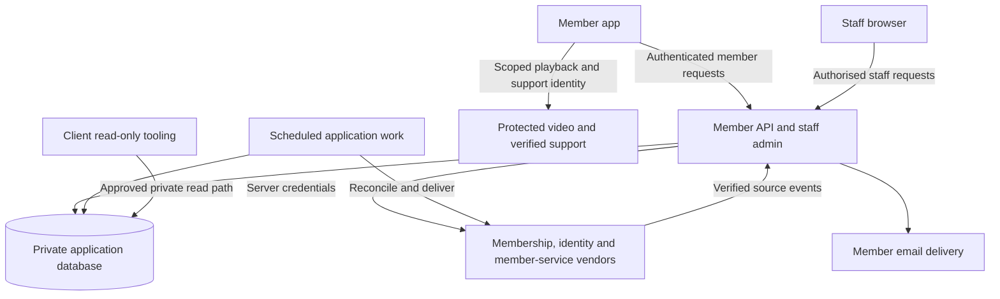

# Architecture

This is the intended system boundary, not a resource inventory or deployment status report. [HLDD 01](hldd/01-platform-api-admin.md) owns platform choices and operational constraints; [HLDD 03](hldd/03-integrations.md) owns vendor responsibilities; the [feature specifications](features/README.md) own required behaviour.

Member and staff identities cross separate authorisation boundaries even though one application serves both. The database is private. The application owns durable member work and integrates external services without putting their general credentials in the app. Scheduled work shares the server's domain logic. The client's read-only view boundary does not grant staff mutation rights.

The authoritative configured topology, resource names and deployment automation are in [infrastructure](../infra/), [workflows](../.github/workflows/) and [the task definition](../taskdef.json). The [API implementation](../apps/api/) defines concrete interfaces and persistence. Consult those sources for environment-specific facts rather than treating this diagram as deployed-state evidence.
