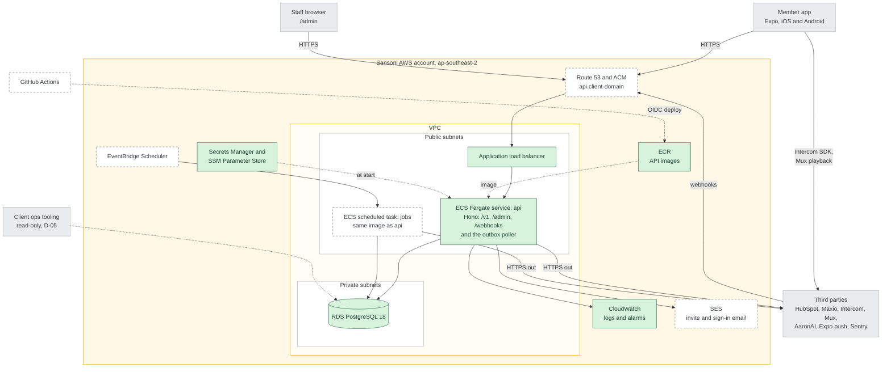

# Architecture

This page shows the V1 architecture for the Sansoni member app and lists the AWS resources it needs. The design reasoning is in [HLDD 01](hldd/01-platform-api-admin.md) and [HLDD 03](hldd/03-integrations.md).

Everything runs in Sansoni's AWS account in `ap-southeast-2` (Sydney), as a single production environment. Terraform in [`infra/`](../infra) creates the resources.

## Diagram

Solid green boxes are already in the Terraform. Dashed boxes are planned. Grey boxes are outside AWS.

How requests flow:

- The app and staff browsers call one host over HTTPS. The load balancer sends every request to the `api` service.
- The API reads and writes RDS. RDS has no route to the internet and only accepts connections from the ECS tasks.
- The API writes changes for third parties to an outbox table in RDS. A poller in the API sends them and retries failures. There is no message queue.
- EventBridge Scheduler starts the `jobs` task for nightly work, e.g., the full Maxio pull.
- Maxio and Mux send webhooks to `/webhooks/*` on the same host. SES reports email bounces through SNS to the same path.
- The app talks to two third parties directly. It uses the Intercom SDK for support and plays Mux video with URLs that the API signs.
- The ECS tasks have public IP addresses, so they reach third parties through the internet gateway without a NAT.

## AWS resources

| Resource                                              | Purpose                                                          | Status                      |
| ----------------------------------------------------- | ---------------------------------------------------------------- | --------------------------- |
| VPC, 2 public and 2 private subnets, internet gateway | Network for the load balancer, tasks and database                | In Terraform                |
| Application load balancer                             | HTTPS entry point for the app, `/admin` and webhooks             | In Terraform (HTTP only)    |
| ECS cluster and Fargate service `api`                 | Runs the API container, 0.25 vCPU and 512 MB, ARM                | In Terraform                |
| ECR repository                                        | Stores API images, tagged by git commit                          | In Terraform                |
| RDS PostgreSQL 18, `db.t4g.micro`                     | Main database, single AZ, encrypted, 7-day backups               | In Terraform                |
| Secrets Manager                                       | Database password, created and rotated by RDS                    | In Terraform                |
| CloudWatch log group                                  | API logs, kept 30 days                                           | In Terraform                |
| IAM execution role                                    | Lets ECS pull the image, write logs and read secrets             | In Terraform                |
| Resource group                                        | Lists every resource with the project's `Project` tag            | In Terraform                |
| Route 53 record and ACM certificate                   | `api.<client-domain>` over HTTPS                                 | Planned, needs DNS (DEP-25) |
| EventBridge Scheduler and ECS task `jobs`             | Nightly and hourly jobs                                          | Planned                     |
| SES with a verified domain                            | Invite and sign-in email                                         | Planned                     |
| SNS topic                                             | SES bounces and complaints                                       | Planned                     |
| SSM Parameter Store                                   | Third-party credentials                                          | Planned                     |
| CloudWatch alarms                                     | 5xx rate, task restarts, failed outbox rows, RDS storage and CPU | Planned                     |
| IAM role for GitHub Actions (OIDC)                    | Lets CI push images and deploy without stored keys               | Planned                     |
| S3 bucket for Terraform state                         | Created by Sansoni before the first `terraform init`             | Needed first                |

## Third-party access

The API needs these credentials. Each is stored in SSM Parameter Store and never in the app.

| System   | Access                                                                                           |
| -------- | ------------------------------------------------------------------------------------------------ |
| Maxio    | Read-only API key and webhooks, AU and NZ accounts (memberships, payments, subscription changes) |
| HubSpot  | Private app token. Sam to confirm the exact scopes.                                              |
| Intercom | Identity verification secret                                                                     |
| Mux      | API token and playback signing key                                                               |
| AaronAI  | Service credential                                                                               |
| Sentry   | DSN for the API and the app                                                                      |

The app also needs Apple and Google developer accounts to publish to the stores.
