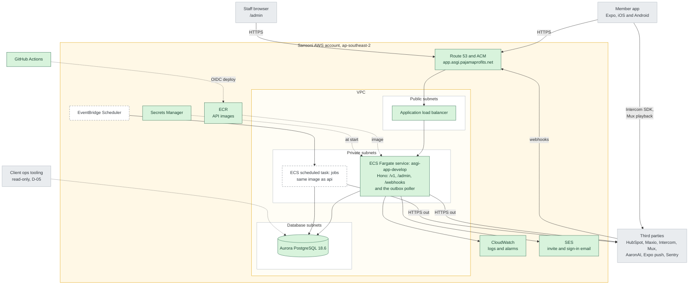

# Architecture

This page shows the V1 architecture for the Sansoni member app and lists the AWS resources it needs. The design reasoning is in [HLDD 01](hldd/01-platform-api-admin.md) and [HLDD 03](hldd/03-integrations.md).

AWS resources run in Sansoni's account `806968064090` in `ap-southeast-2` (Sydney). The current environment is `develop`, which is staging and deploys from `main`. The `production` branch targets production, which is not set up yet. Resources are defined with Terragrunt in [infra/](../infra/README.md), which was copied from Sansoni's `devops-infrastructure-asgi-app` repository. Sansoni DevOps maintains it. Rodney's handoff is complete per Tom (20 October 2026); the [member API handoff](member-api.md) records the next delivery.

The app repository is [Sansoni-Management-Dev-Team/asgimaster-app](https://github.com/Sansoni-Management-Dev-Team/asgimaster-app). Its `.github/workflows/main.yml` and `taskdef.json` follow Sansoni's empireone deploy pattern using shared actions from `devops-github-workflows`. Relevant pushes to `main` build the API image, upload an environment file to S3, push to ECR, register a task definition and update the ECS service. Pull requests run lint, typecheck, tests and a Docker build without deploying. There is no migration step yet.

## Diagram

Solid green boxes are provisioned by Sansoni DevOps. Dashed boxes are planned. Grey boxes are outside AWS. The API routes, admin, poller and scheduled jobs shown here describe the V1 design. The service runs the real Hono API image, which currently implements only `/` and `/health`. CloudWatch logs and SES domain verification exist, while application email delivery and alarms remain implementation work.

How requests flow:

- The app and staff browsers call one host over HTTPS. The load balancer sends every request to the `asgi-app-develop` service.
- The API reads and writes RDS. RDS has no route to the internet and only accepts connections from the ECS tasks.
- The API writes changes for third parties to an outbox table in RDS. A poller in the API sends them and retries failures. There is no message queue.
- EventBridge Scheduler starts the `jobs` task for nightly work, e.g., the full Maxio pull.
- Maxio and Mux send webhooks to `/webhooks/*` on the same host. SES reports email bounces through SNS to the same path.
- The app talks to two third parties directly. It uses the Intercom SDK for support and plays Mux video with URLs that the API signs.
- The ECS tasks run in private subnets and reach third parties through a NAT gateway.

## AWS resources

| Resource                                                                    | Purpose                                                               | Status                                                                                           |
| --------------------------------------------------------------------------- | --------------------------------------------------------------------- | --------------------------------------------------------------------------------------- |
| VPC, public, private and database subnets, internet gateway and NAT gateway | Network for the load balancer, tasks and database                     | Provisioned by Sansoni DevOps.                                                                   |
| Application load balancer                                                   | HTTPS entry point for `app.asgi.pajamaprofits.net`                    | Provisioned. Target group checks `/`, which the API answers without a database call.             |
| ECS cluster `asgi-main-develop` and service `asgi-app-develop`              | Runs one task with 0.25 vCPU and 512 MB on x86                        | Running the real Hono API image; health routes only.                                    |
| ECR repository `asgi-asgi-app-develop`                                      | Stores API images tagged `v.<short sha>`                              | Provisioned with immutable tags and scanning on push.                                            |
| Aurora Serverless v2, PostgreSQL 18.6                                       | Main database `asgi`, capacity from 0 to 2 units, 7 days of backups   | Provisioned with deletion protection.                                                            |
| Secrets Manager `asgi-secrets-develop`                                      | Database credentials                                                  | Used by the deploy workflow; application database connectivity remains to be validated. |
| CloudWatch log group `/ecs/asgi-app-develop`                                | API logs, kept for 14 days                                            | Provisioned.                                                                                     |
| IAM execution role `asgi-ecs-task-execution-develop`                        | Image pulls, logs and secret reads                                    | Provisioned. Can read the app's environment files in S3.                                         |
| IAM task role `asgi-app-develop`                                            | ECS Exec                                                              | Provisioned. SES send permission still needed.                                                   |
| Route 53 and ACM                                                            | HTTPS for `app.asgi.pajamaprofits.net`                                | Provisioned.                                                                                     |
| SES domain `asgi.pajamaprofits.net`                                         | Invite and sign-in email                                              | Verified domain. Application integration still planned.                                          |
| S3 bucket `asgi-main-develop`                                               | Versioned storage                                                     | Provisioned. Used for the `.env` file; the execution role can read the app's files.     |
| EventBridge Scheduler and ECS task `jobs`                                   | Nightly and hourly jobs                                               | Planned.                                                                                         |
| SES configuration set and SNS topic                                         | Email bounces and complaints                                          | Planned.                                                                                         |
| CloudWatch alarms                                                           | 5xx rate, task restarts, failed outbox rows, database storage and CPU | Planned.                                                                                         |
| IAM role `github-role`                                                      | OIDC access for GitHub Actions                                        | Provisioned.                                                                                     |

Resource names above are derived from the asgi Terragrunt inputs and the Terraform modules in `infra/modules`. The ECR module adds the project and environment to the `asgi-app` config key, which produces `asgi-asgi-app-develop`.

The `.env` file uses the provisioned `asgi-main-develop` bucket, and the task execution role can read the app's files there. The deploy waits until the new tasks are healthy, so a deploy that cannot start fails the workflow. The existing target group checks `/` and the container checks `/health`. Both routes return 200 without a database call. The first successful API deployment is complete. Database migrations need a separate agreement when they exist.

## Third-party access

The API needs these credentials. They are not configured yet. Agree their delivery to Sansoni DevOps for storage in `asgi-secrets-develop`. They never belong in the app.

| System   | Access                                                                                           |
| -------- | ------------------------------------------------------------------------------------------------ |
| Maxio    | Read-only API key and webhooks, AU and NZ accounts (memberships, payments, subscription changes) |
| HubSpot  | Private app token. Sam to confirm the exact scopes.                                              |
| Intercom | Identity verification secret                                                                     |
| Mux      | API token and playback signing key                                                               |
| AaronAI  | Service credential                                                                               |
| Sentry   | DSN for the API and the app                                                                      |

The app also needs Apple and Google developer accounts to publish to the stores.
